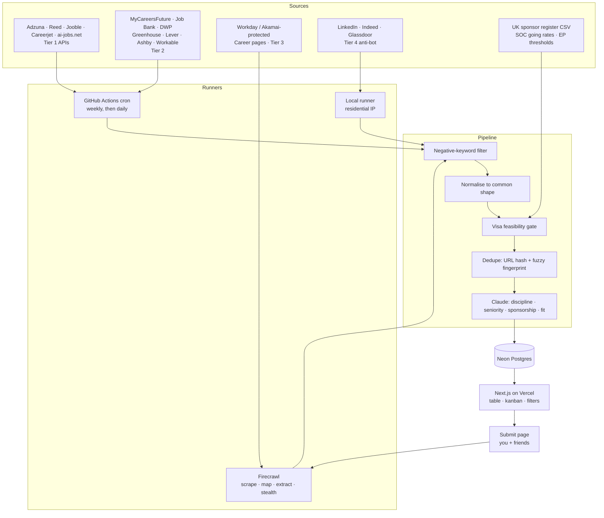

# Job Hunter: Architecture & Plan

A private job-search home base for **electrical engineering and AI roles** in
**Canada, Singapore and the UK**. Aggregates postings from job boards, company
ATS feeds and hand-dropped links, normalises them into one database, and gives a
single UI to triage, filter and track applications through to offer.

Status: **built.** Phases 0-2 are implemented, see the [README](../README.md)
for setup. This document remains the design record and the reasoning behind
each decision.

---

## 1. Goals

| # | Goal |
|---|---|
| G1 | One database of every job worth looking at, with application link, company, role type and the standard hiring metadata |
| G2 | Automatic refresh on a schedule, **weekly to start, daily later** with no re-architecture |
| G3 | Coverage weighted to Canada, Singapore and London/England |
| G4 | Coverage weighted to electrical/hardware engineering and AI, evenly split, including where they overlap |
| G5 | **Hide roles that can't sponsor**, since UK and Singapore both require it, see §3 |
| G6 | A friend can drop a link in and it gets parsed, deduped and queued for triage |
| G7 | Private: the owner plus a handful of invited contributors, never public |
| G8 | A UI that is genuinely pleasant to live in, because job hunting is grim enough |

---

## 2. What we're looking for

The role focus drives source selection more than the country focus does, because
**EE and AI employers live on different platforms**. Getting this wrong means
building the right system pointed at the wrong places.

### Disciplines: split evenly between the two

**Electrical / hardware**
Analog & mixed-signal · RF & microwave · digital design / RTL / FPGA ·
ASIC & VLSI & physical design · design verification · embedded & firmware ·
power electronics · PCB & hardware design · semiconductor process, device &
yield · test & characterisation · controls & instrumentation · DSP ·
photonics & optoelectronics

**AI**
ML engineering · ML research · MLOps & ML infrastructure · computer vision ·
NLP & LLMs · robotics & autonomy · data science · applied AI engineering ·
AI compilers & accelerators

Crawl budget splits 50/50, with fit scoring left to sort the results rather than
the crawler pre-judging which half matters.

### The overlap gets a boost

Roles sitting in both, AI accelerators, edge ML and TinyML, ML compilers
(MLIR/TVM), silicon for datacentre AI, neuromorphic, hardware-aware model design
, get a first-class `hardware_ai` flag, a dedicated filter and a fit-score boost.
This niche is unusually well-served by the three target markets: Toronto has
Tenstorrent, Untether AI and Blumind; Singapore is one of the densest
semiconductor clusters on earth; the UK has Arm, Graphcore, Imagination and
Alphawave.

### Seniority: early career, judged on capability not years

Calibrated to early career and new graduate, but **years-of-experience is a soft
signal, not a filter**. A posting asking for 5+ years is down-weighted, never
excluded: plenty of them are written aspirationally and hire on demonstrated
capability. Claude scores against what the role actually requires versus what
you can actually do, rather than pattern-matching a number.

Graduate schemes get their own flag and cadence, because they open on fixed
annual cycles rather than continuously, and missing the window costs a year.

### Query sets and, more importantly, negative filters

`electrical` is one of the noisiest search terms in existence, and `AI` is close
behind. Without filtering, the inbox fills with electricians and AI annotation
gigs and becomes useless. Both stages are needed:

- **Positive terms** per discipline, per market, fanned out across Tier 1 APIs
- **Negative keywords** applied before anything is stored, electrician,
  electrical technician/installer/apprentice, maintenance electrician, field
  service technician, HVAC, panel wiring, cable installation, electrical
  estimator, sales engineer, recruiter, AI trainer, data annotation, prompt
  writing gigs
- **Claude classification** as second pass, assigning discipline and seniority
  and catching what keyword rules can't, a "Systems Engineer" that's really RTL
  design, or an "AI Engineer" that's really a CRM administrator

---

## 3. Work authorisation: the hardest filter, and the most valuable

Sponsorship is needed in **Singapore and the UK**; **Canada needs none**. This
is not a tag to display, it is a *feasibility gate*, and most of it can be
computed deterministically from published data rather than guessed at by a model.

It is also where this tool earns its keep fastest. A large share of UK and
Singapore postings are legally impossible regardless of how good a candidate is,
and every hour spent on those is wasted.

### United Kingdom: two hard gates

**Gate 1: the employer must hold a sponsor licence.** The Home Office publishes
the *Register of Worker and Temporary Worker Licensed Sponsors* as a **CSV on
gov.uk**, updated at least monthly. It carries sponsor name, town/city, licence
rating and approved routes. An employer not on it *cannot* sponsor, a clean
binary check against a downloadable file, no inference required.

**Gate 2: salary must clear the new-entrant threshold.** As a recent graduate
the new-entrant rate applies: **the higher of £33,400 or 70% of the going rate**
for the role's occupation code, versus £41,700 standard. New-entrant status
lasts a maximum of four years, and discounts can't be stacked with shortage-list
rates.

Blunt implication: **typical UK graduate engineering salaries sit below
£33,400**, so a substantial fraction of genuine entry-level UK roles cannot be
sponsored at any price. Filtering them out is the single highest-value thing
this system does for the UK market.

### Singapore: one gate, and an unusually clean data source

**Employment Pass minimum qualifying salary** for the youngest bracket is
**S$5,600/month** (S$6,200 financial services), rising with age. Plus at least
40 points on **COMPASS**. From **1 January 2027 this rises to S$6,000 / S$6,600**
for new applications: so a role starting next year faces the higher bar, and the
threshold must be **date-aware**, not a constant.

Then the useful part. Under the **Fair Consideration Framework**, employers must
advertise a role on **MyCareersFuture for at least 14 consecutive days** before
filing an EP application, with narrow exemptions (intra-corporate transfers, and
roles at S$22,500+). Two consequences:

1. **MyCareersFuture is structurally the most complete list of sponsorable
   Singapore roles that exists**, not merely a good source, but one employers
   are legally obliged to post to before they can hire a foreigner.
2. It carries **mandatory salary ranges**, so the EP threshold becomes a numeric
   filter rather than a guess.

Combined: Singapore feasibility is close to exactly computable. That is rare and
worth exploiting hard.

### How it's implemented

| Gate | Method | Determinism |
|---|---|---|
| UK sponsor licence | Match employer against the gov.uk CSV, re-imported monthly | Deterministic, fuzzy name matching |
| UK salary floor | Compare against £33,400 and 70% of the SOC going rate | Deterministic where salary is published |
| SG salary floor | Compare against the date-aware EP threshold | Deterministic on MyCareersFuture, inferred elsewhere |
| Sponsorship intent | Claude reads the posting for explicit statements | Inferred |

Each job gets `visa_feasible_uk` / `visa_feasible_sg` as
`yes | no | unknown | threshold_risk`, with a stored reason. **`no` hides by
default but is never deleted**, and one click reveals it, a wrong sponsor-name
match should cost a click, not an opportunity.

### The strategic consequence

The roles that survive these gates skew toward larger, better-paying employers
semiconductor multinationals, AI labs, finance-adjacent engineering. Which is
precisely the Workday and Greenhouse target-company set in §4. Meanwhile
**Canada, where no sponsorship is needed, is the volume market**, and its crawl
can run wide while UK and Singapore run narrow and deep.

---

## 4. Decisions

| Area | Decision |
|---|---|
| Source strategy | Official APIs first; scrape where there's no API or scraping is materially better. Tiered by anti-bot difficulty, see §5 |
| Firecrawl | Yes, used surgically, see §6 |
| Hosting | Next.js on **Vercel** (Hobby) |
| Database | **Neon Postgres**: verified against Supabase, see §8 |
| Ingestion runner | **GitHub Actions cron**, not Vercel cron, see §9 |
| Enrichment | Claude, for URL parsing, discipline classification, sponsorship reading and fit scoring |
| Auth | *Parked.* Working default: Google sign-in + email allowlist, plus a tokenised no-login submit page |
| Theme | Deep forest base, violet accent, see §12 |

---

## 5. Source strategy

Sources are graded by how hard they fight back. This grade decides **where the
crawler runs**, the most important practical constraint in the system.

### Tier 1: Official APIs

Free keys, stable contracts, run anywhere.

| Source | Markets | Focus | Notes |
|---|---|---|---|
| **Adzuna** | CA, SG, UK | Both | Free key, ~1,000 calls/month. Only one covering all three markets |
| **Reed.co.uk** | UK | Both, strong EE | Free key. Largest UK board |
| **Jooble** | CA, SG, UK | Both | Free key via request form |
| **Careerjet** | CA, SG, UK | Both | Partner key, ~1,000 req/hour |
| **ai-jobs.net** | Global | AI only | **Free public JSON API**, 200 most recent, refreshed ~2-hourly, explicitly licensed for republishing |

### Tier 2: Open endpoints and open data

No official API, no anti-bot. As easy to consume as Tier 1, and in places
**better data than the aggregators sell**, this is where "scrape because it's an
advantage" genuinely pays.

| Source | Markets | Notes |
|---|---|---|
| **MyCareersFuture** | SG | Open JSON endpoint, ~90k listings, mandatory salary ranges. **The single most important source in the system**, see §3 |
| **Job Bank** | CA | Federal portal, bulk postings on `open.canada.ca` |
| **Find a Job (DWP)** | UK | Government portal feed |
| **UK sponsor register** | UK | Reference data, not jobs, gov.uk CSV, re-imported monthly |
| **ATS boards** | All | Free public JSON per company, see below |

### The ATS split: the key insight for these roles

Every major ATS exposes a free, unauthenticated JSON endpoint so customers can
embed their board. **Which ATS a company uses correlates strongly with whether
it's an AI or an EE employer**, so both families are needed:

| ATS | Endpoint | Who's on it |
|---|---|---|
| Greenhouse | `boards-api.greenhouse.io/v1/boards/{token}/jobs?content=true` | AI labs, scale-ups |
| Lever | `api.lever.co/v0/postings/{company}?mode=json` | AI startups; clean `descriptionPlain` |
| Ashby | `api.ashbyhq.com/posting-api/job-board/{company}` | Newer AI companies |
| Workable | public careers endpoints | Mid-size, mixed |
| **Workday** | `{tenant}.wdN.myworkdayjobs.com/wday/cxs/{tenant}/{site}/jobs` | **Semiconductor, defence, aerospace, large EE employers** |

Workday matters disproportionately here, chip companies, the Singapore fabs, UK
aerospace and defence all sit on it, and those are exactly the employers big
enough to clear the visa thresholds in §3. Two caveats: pagination hard-caps at
20 per request, and it sits behind **Akamai bot management** that blocks naive
single-IP polling within minutes. So Workday runs from the local runner or
through Firecrawl stealth. Data-centre subdomains vary (`wd1`, `wd3`, `wd5`…) and
must be read from each company's real careers URL, not assumed.

Rather than hand-maintaining which company uses which ATS, an **`ats_detect`
routine probes all five endpoints for a company slug** and records what answers.
Adding a target company becomes: paste the name, get its board.

### Tier 2b: Discipline-specific boards

| Source | Market | Focus |
|---|---|---|
| **E&T Jobs** (IET) | UK | Europe's largest engineering body's board, core UK EE source |
| **CV-Library**, **Totaljobs** | UK | Large UK generalists with deep EE inventory |
| **IEEE Job Site** | Global, incl. CA | EE and academia |
| **Eluta.ca** | CA | Indexes Canadian employer sites directly, surfacing roles never posted to aggregators |
| **Jobstreet** (SEEK) | SG | Dominant SG board for engineering |
| **Wellfound**, **Welcome to the Jungle** | All | AI startups |

*Not building an adapter for engineering.com, its board closed permanently in
February 2026.*

### Tier 3: Plain HTML career pages

Companies not on any major ATS. Handled by Firecrawl rather than hand-written
selectors (§6). Runs fine from datacentre IPs.

### Tier 4: Anti-bot protected: LinkedIn, Indeed, Glassdoor

Behind Cloudflare bot management and datacentre-IP blocklists. Verified
constraint: **GitHub Actions runners use datacentre IPs and get CAPTCHA'd or
blocked within a few requests.** Firecrawl stealth does not reliably solve
LinkedIn either, which additionally sits behind an auth wall.

Handled by:

1. **Local runner (recommended, $0).** The same crawler binary runs on your own
   machine behind your residential IP, on a local timer, pushing to the same API
   the cloud crawler uses. `pnpm crawl --tier=4`
2. **Residential proxies (~$30-100/month).** Only if this tier must run
   unattended. Needs fingerprint spoofing and still breaks.
3. **Link drops.** Already a core feature, so this tier degrades gracefully.

Start with 1 and 3.

### Why this shape

Indeed's Publisher API was discontinued in 2023 and its replacements are
partner-gated. Glassdoor's public API is long retired and its inventory is
largely Indeed's anyway. LinkedIn has never had a public jobs API. No serious
system can be *built around* those three, but a tiered adapter model lets them
be added opportunistically without the rest depending on them.

---

## 6. Firecrawl: where it earns its keep

Worth having, for exactly three things.

**Use it for:**

1. **Paste-a-link parsing.** `/scrape` returns clean markdown from any job URL,
   whatever the site: precisely the input Claude wants for the friend flow, and
   it removes the need for per-site parsers. This alone justifies it.
2. **Tier 3 career pages.** `/map` discovers job URLs across a careers site, then
   `/extract` with a schema pulls structured postings. Replaces a pile of brittle
   per-company selectors with one adapter.
3. **Workday and other Akamai-protected boards.** Stealth mode (5 credits/page)
   answers the bot management that blocks plain fetches, directly relevant,
   since that's where the visa-viable EE employers live.

**Don't use it for** anything with a free JSON endpoint, Greenhouse, Lever,
Ashby, ai-jobs.net, MyCareersFuture, Adzuna, Reed. Firecrawl there burns credits
for strictly worse data. Enforced by per-source `fetch_via` config rather than
by discipline.

**It does not solve LinkedIn.** The local runner stays the answer for Tier 4.

**Credit budget.** Free tier is 500/month, too thin. Hobby is $16/month for
3,000, which fits with headroom:

| Use | Monthly credits |
|---|---|
| Pasted links (~25/week, 1 credit) | ~100 |
| Tier 3 career pages (~20 companies, map + ~5 pages, weekly) | ~480 |
| Workday listing pages via stealth (~15 companies, 2 pages, 5 credits, weekly) | ~600 |
| Job detail pages, fetched only after title and visa filtering | ~200 |
| **Total** | **~1,400 of 3,000** |

Detail pages are fetched *after* the negative-keyword and visa-feasibility
filters, so credits are never spent reading a job about panel wiring or one that
legally can't sponsor.

---

## 7. The "links I put in" model

Three different things get pasted in, unified into one `sources` table with a
`kind` discriminator:

| Kind | Example | Behaviour |
|---|---|---|
| `job` | A link to one posting | Parsed once into a job row. This is the friend flow |
| `search` | A board search URL or saved query | Re-run every cycle, new results appended |
| `company` | A careers page or ATS board | `ats_detect` runs, then the board is polled every cycle |

One paste box, one table, three behaviours, the system infers the kind from the
URL and asks only when genuinely ambiguous.

---

## 8. Database: Neon, verified

Checked against Supabase and Vercel Postgres before confirming.

- **Vercel Postgres is Neon.** Vercel retired its own offering and the
  marketplace option is Neon underneath, so that isn't a real choice.
- **Supabase free tier pauses a project after 7 days of inactivity.** For an app
  whose heartbeat is a *weekly* cron, that idles dangerously close to the
  threshold. Neon scales compute to zero after 5 minutes idle and wakes on
  connect: same saving, no cliff. This decided it.
- Neon free tier: 0.5 GB storage, 100 CU-hours/month, unlimited branching.
- Postgres brings `tsvector` full-text search and `pgvector` for semantic dedupe
  and fit scoring: both wanted later, neither needing a new datastore.

**The one real constraint: 0.5 GB.** Full descriptions are the only thing big
enough to threaten it (~100k would fill it). Mitigated by design:

- capped raw description (~8 KB) plus the Claude summary
- full text kept only for jobs promoted to `shortlist` or beyond
- auto-prune `inbox` jobs older than 90 days that were never actioned
- `raw` provider payloads as compressed JSONB, pruned on the same clock

Neon's paid tier is $19/month if it's ever outgrown, with no migration.

---

## 9. Architecture



### Why GitHub Actions rather than Vercel cron

Vercel's Hobby plan caps cron **frequency at once per day** and function duration
well below what a multi-source crawl needs. GitHub Actions is free, has no
meaningful duration limit, keeps run logs, retries natively, and gives a manual
"Run workflow" button. It also runs the *same* code as the local Tier 4 runner.
Weekly → daily → hourly is a one-line cron change.

Vercel still hosts the app, the API and an authenticated "crawl now" route.

---

## 10. Data model

```
users              id, email, name, image, role(owner|contributor), created_at

companies          id, name, slug, website, ats_type, ats_tenant, ats_site,
                   hq_country, is_target,
                   uk_sponsor_licence(bool), uk_sponsor_rating,
                   uk_sponsor_routes text[], uk_sponsor_matched_name,
                   notes

sources            id, kind(job|search|company), tier(1-4), provider, label,
                   config jsonb, fetch_via(http|firecrawl|firecrawl_stealth),
                   enabled, cadence, last_run_at, last_status

jobs               id, source_id, provider_job_id,
                   url, canonical_url, url_hash,
                   title, company_id, company_name_raw,
                   location_raw, city, country, remote_type(onsite|hybrid|remote),
                   employment_type, seniority, is_grad_scheme,
                   discipline, sub_discipline, is_hardware_ai,
                   salary_min, salary_max, salary_currency, salary_period,
                   visa_feasible_uk, visa_feasible_sg, visa_reason,
                   description_raw, description_summary,
                   posted_at, closes_at, first_seen_at, last_seen_at, is_open,
                   stage(inbox|shortlist|applied|interview|offer|rejected|archived),
                   dedupe_key, duplicate_of, raw jsonb

job_sightings      job_id, source_id, url, seen_at      -- same job, many boards

job_tags           job_id, tag                          -- FPGA, PyTorch, RTL…

enrichments        job_id, model, content_hash, fit_score, reasons jsonb,
                   sponsorship_statement, tech_stack text[]

uk_sponsors        name, normalised_name, town, rating, routes text[],
                   imported_at                          -- gov.uk CSV, monthly

soc_going_rates    soc_code, occupation, going_rate, new_entrant_rate

visa_thresholds    market, effective_from, min_salary, currency, period, notes

applications       id, job_id, applied_at, cv_version, cover_letter_url, notes

job_events         id, job_id, type, occurred_at, note   -- full stage history

submissions        id, submitted_by, submitter_label, raw_url, note,
                   status(pending|parsed|failed|duplicate), job_id, created_at

crawl_runs         id, source_id, started_at, finished_at, status,
                   found, filtered, created, updated, credits_used, errors jsonb
```

`visa_thresholds` is a table rather than a constant specifically because
Singapore's EP floor rises on 1 January 2027, the gate must be date-aware, and
UK figures move most years too.

### Dedupe

The same role legitimately appears on four boards, so collapsing is essential.

1. **Exact:** normalise the URL (strip `utm_*`, `gclid`, `ref`, session ids,
   trailing slashes), hash it, unique index on `url_hash`.
2. **Fuzzy:** `dedupe_key = hash(normalised company + normalised title +
   normalised city)`. Collisions link via `duplicate_of` rather than being
   dropped.
3. **UI payoff:** one card per role showing every board it was seen on, "also on
   Reed, Adzuna, LinkedIn". Apply through whichever link you prefer.

Nothing is hard-deleted by the crawler; vanished postings get `is_open = false`
so the history of what you applied to survives.

---

## 11. Claude enrichment

Five jobs, all cached by `content_hash` so nothing is paid for twice:

1. **Parse**: a pasted URL (via Firecrawl markdown) becomes structured fields.
   This is what makes the friend flow work: they paste, they don't fill a form.
2. **Classify**: discipline and sub-discipline from §2, seniority, grad-scheme
   detection and the `hardware_ai` flag.
3. **Read sponsorship**: extract explicit statements ("no sponsorship
   available", "we sponsor Skilled Worker visas", "must have existing right to
   work"). This is the inferred half of §3; the salary and register checks are
   deterministic and run first.
4. **Tag**: tech stack and remote policy.
5. **Score**: fit against your CV, judged on capability against actual
   requirements rather than the stated years number, with reasons, so the weekly
   digest leads with the ten worth reading.

Batched and cached, this is a few dollars a month.

---

## 12. Theme: deep forest, violet accent

Near-black green ground so dense tables stay calm; violet reserved for the few
things you actually click.

```css
--bg:          #0A1410   /* page ground */
--surface:     #0F1C17   /* cards, table rows */
--surface-2:   #14241D   /* hover, raised */
--border:      #1E3329
--text:        #E6F0EA
--text-muted:  #8FA89B

--primary:     #8B5CF6   /* violet, buttons, focus rings */
--primary-hi:  #A78BFA   /* violet text on dark, higher contrast */
--primary-fg:  #FFFFFF
```

Pipeline stage colours, kept inside the palette:

| Stage | Colour |
|---|---|
| Inbox | violet `#A78BFA` |
| Shortlist | soft violet `#C4B5FD` |
| Applied | amber `#F59E0B` |
| Interview | teal `#2DD4BF` |
| Offer | emerald `#34D399` |
| Rejected | muted rose `#F87171` |

Visa feasibility is shown as a small badge, not a stage colour: `yes` unmarked,
`threshold_risk` amber, `no` dimmed with the row collapsed by default.

Links use `--primary-hi` rather than `--primary`, since the darker violet doesn't
clear contrast minimums against the green ground at small sizes.

---

## 13. Phases

### Phase 0: Useful on day one
Next.js + Neon + Drizzle scaffold, theme, auth, schema and migrations. Jobs table
with filters and sort, kanban pipeline board, job detail view. Paste-a-URL add
with Firecrawl + Claude parsing. Tokenised submit page. Manual entry and edit.

*Deliberately no crawler yet.* This alone replaces a spreadsheet, and it proves
the schema against real jobs before anything automated writes to it.

### Phase 1: It fills itself, and it filters hard
Provider adapter interface. Tier 1 adapters (Adzuna, Reed, Jooble, Careerjet,
ai-jobs.net) and Tier 2 (MyCareersFuture, Job Bank, Greenhouse, Lever, Ashby,
Workable) plus `ats_detect`. Negative-keyword filter.
**Visa feasibility gate: UK sponsor register import and the SG/UK salary
thresholds.** These are cheap to build and eliminate the largest single category
of wasted effort, so they belong here rather than later. Normalise → dedupe →
persist. GitHub Actions weekly cron plus manual trigger. `crawl_runs` dashboard.
Saved searches per market and discipline.

### Phase 2: It gets opinionated
Claude classification, `hardware_ai` detection, sponsorship-statement reading and
fit scoring. Weekly digest email of top matches. Firecrawl adapters for Workday
and Tier 3 career pages. Seed target-company list. Grad-scheme cycle tracking.
Local Tier 4 runner. Flip to daily.

### Phase 2b: Added during the build
Light **and** dark themes with a three-state toggle (light / dark / system) and
a pre-paint script so a dark-mode user never sees a white flash. A **starred**
folder, deliberately exempt from the visa gate and the stage filter, if you
starred it, you see it.

### Phase 3: Nice to have
MCP server exposing the tracker to Claude, so you can ask "what have I applied to
in Singapore this month?" and add jobs conversationally. Analytics, response
rates by source, market and discipline. CV version tracking per application.
Stale-application nudges.

---

## 14. Cost

| Item | Cost |
|---|---|
| Vercel Hobby | $0 |
| Neon free tier | $0 |
| GitHub Actions | $0 |
| Adzuna / Reed / Jooble / Careerjet / ai-jobs.net | $0 |
| Firecrawl Hobby | $16/month |
| Claude API | a few $/month |
| *Optional* residential proxies for unattended Tier 4 | $30-100/month |

Baseline: **~$16-20/month.**

---

## 15. Risks

| Risk | Mitigation |
|---|---|
| Sponsor-register name matching fails: "DeepMind" vs its legal entity | Fuzzy match with a manual override per company; `visa_feasible = no` hides rather than deletes, and unhiding is one click |
| Visa thresholds change (SG rises Jan 2027) | `visa_thresholds` is date-aware reference data, not a constant; register re-imported monthly |
| Salary not published, so the gate can't compute | Falls through to `unknown`, never `no`, absent data must not silently hide a good role |
| `electrical` and `AI` queries flood the inbox | Two-stage filter: negative keywords before storage, Claude classification after (§2) |
| Workday's Akamai blocks the crawler | Firecrawl stealth or local runner; per-source `fetch_via` config |
| Tier 3/4 scrapers break | Per-source health in `crawl_runs`; a broken source warns instead of failing the run; Tiers 1-2 carry coverage |
| Firecrawl credits overrun | Detail pages fetched only post-filter; `credits_used` tracked per run; free JSON endpoints never routed through it |
| Neon 0.5 GB ceiling | Capped descriptions, summary-only for inbox, 90-day prune (§8) |
| Adzuna 1k calls/month across many queries | One call per saved search per cycle; discipline queries spread across providers |
| Duplicate flood across boards | Two-stage dedupe with sightings (§10) |
| MyCareersFuture endpoint is undocumented | Best-effort with its own health check; Adzuna SG and Jobstreet back up the market. Given its FCF role (§3), a fallback matters more here than anywhere else |
| Weekly cadence misses fast-moving AI roles | Cadence is per-source config, ai-jobs.net and ATS boards can go daily while slower sources stay weekly |
